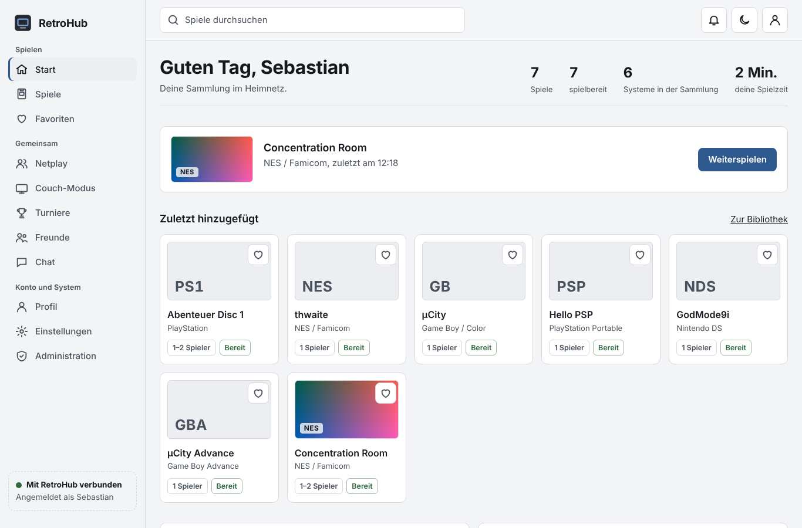

# RetroHub (English summary)

**Your own retro game library on your home network** – runs as an unprivileged LXC container on Proxmox VE and is played in the browser on laptops, phones and TVs. No cloud, no third-party accounts, works offline.

> The user interface and the full documentation are in **German** ([README.md](README.md)). This page is a short overview.



> **Important:** RetroHub does **not include any games, ROMs or BIOS files** and does not download any. Only add files you have the rights to – e.g. backups of your own cartridges, homebrew or freely licensed games.

## Features

- **Emulators for 35 systems** via EmulatorJS 4.2.3 (NES, SNES, N64, Game Boy/Color/Advance, DS, Virtual Boy, PlayStation, PSP, Master System, Mega Drive, Game Gear, Mega-CD, 32X, Saturn, Atari 2600/5200/7800/Lynx/Jaguar, PC Engine, PC-FX, Neo Geo Pocket, WonderSwan, ColecoVision, 3DO, arcade (FBNeo, MAME 2003+), Amiga, C64/C128/PET/Plus4/VIC-20, MS-DOS). Not possible in the browser: GameCube, Wii, PS2.
- **Game library:** upload (up to 2 GB, multiple files per game), download from a URL, or import from a read-only NAS folder; cover art, description, year, genre; multi-disc games with automatic `.m3u`; BIOS management per system.
- **Save states on the server:** three slots plus autosave on exit, in-game save memory.
- **Kids' profiles with age ratings:** children only see and start games up to their limit; unrated games stay hidden.
- **Couch mode:** one screen runs the game, up to four phones act as controllers (QR code).
- **Netplay** on the local network (experimental) with a built-in server compatible with EmulatorJS.
- Friends, chat, tournaments, full backup including game files, offline installation.

## Installation

Download the latest `RetroHub-vX.Y.Z-AutoInstaller.tar.gz` and its `.sha256` from [Releases](../../releases), copy them to the Proxmox host and run:

```bash
sha256sum -c RetroHub-v*-AutoInstaller.tar.gz.sha256
tar -xzf RetroHub-v*-AutoInstaller.tar.gz && cd RetroHub-v*/
./install.sh --dry-run
./install.sh
```

Step-by-step guide (German): [INSTALLATIONSLEITFADEN.md](INSTALLATIONSLEITFADEN.md).

The installer prints the address and a **setup code** used to create the first (admin) account in the browser. Options are set as environment variables, e.g. `IMPORT_DIR=/mnt/nas/games ./install.sh`; see `./install.sh --help`.

## Development

```bash
npm ci && (cd server && npm ci --omit=dev)
npm run check   # ShellCheck, JS syntax, CSS, version consistency
npm test        # backend test suite
npm run build   # release archive in dist/
```

## License

RetroHub is MIT licensed. Emulators and cores are downloaded during installation and keep their own licenses (EmulatorJS: GPL-3.0) – see [THIRD_PARTY_NOTICES.md](THIRD_PARTY_NOTICES.md). All trademarks belong to their owners; RetroHub is not affiliated with them.
